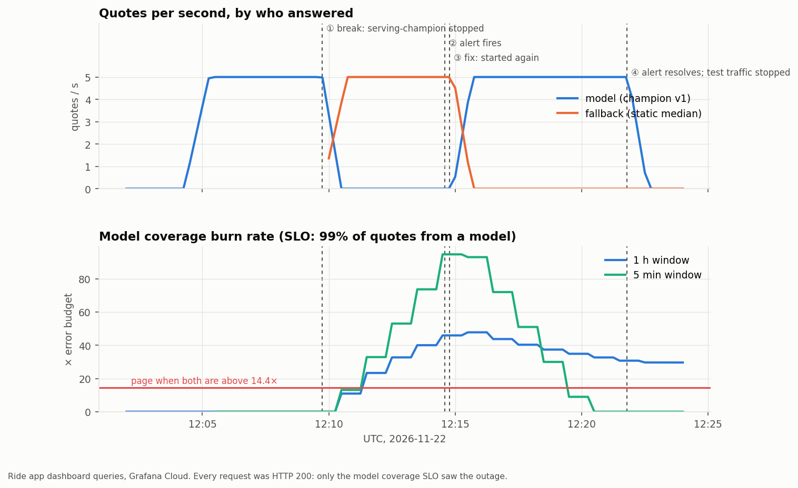
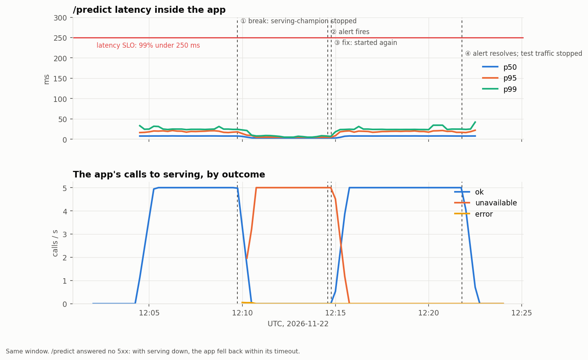
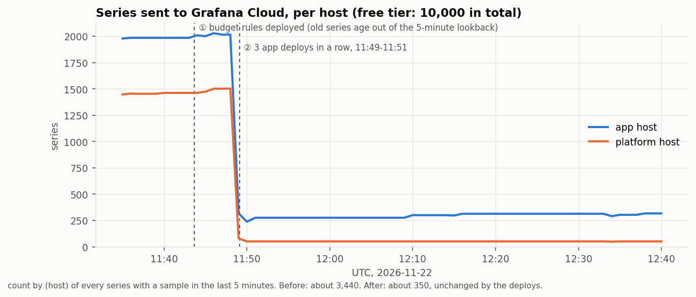

# NYC taxi trip-duration: from stub to production-shaped ML system

A ride-hailing app quoted every trip with a static median. Over two days this repo grows it into a production-shaped ML system on AWS Learner Lab: a data pipeline into Redshift, a gated model pipeline in MLflow, blue-green serving with an approval-gated champion, SLOs with burn-rate alerts in Grafana Cloud, and a support assistant that answers from the company's ops wiki with every answer traced.

## Current state

| Stage | What it delivers | Status |
| --- | --- | --- |
| [S0](stages/S0.md) walking skeleton | A push to `main` is tested, built as a `linux/arm64` image on GHCR and deployed to the app host | ✅ done |
| [S1](stages/S1.md) data pipeline | A month's trip file landing in the bucket ends up in Redshift and the `zone_hour_stats` mart with no one pressing a button; schema drift and bad months never reach the mart | ✅ done (2024-01 to 2024-04) |
| [S2](stages/S2.md) model pipeline | `train_model` trains LightGBM, registers it in MLflow, and only a version that beats the incumbent becomes `challenger` | ✅ version 1: holdout MAE 3.64 min vs 3.96 for the v1 baseline |
| [S3](stages/S3.md) serving, promotion, blue-green | `/predict` quotes with the `champion`; promotion is a reviewed click; every deploy goes to the idle colour and switches only after its checks pass | ✅ champion v1 promoted through `production`; rollback in 3.2 s |
| [S4](stages/S4.md) restore service | Runbook, restore automation and decision 012 | 🟡 open: the lab is up, the runbook and automation aren't written |
| [S5](stages/S5.md) observability | Metrics in Grafana Cloud under a series budget, three SLOs, burn-rate alerts that fired for a real outage | ✅ 426 series of 10,000; alert fired 4 min 51 s after the break |
| [S6](stages/S6.md) RAG assistant | `POST /assist` answers from the ops wiki, re-read daily with only changes embedded, traced in Langfuse | ✅ wiki-only questions answered correctly, with sources and traces |
| S7 onward | MCP tools for the assistant, gameday | not started: each handout arrives with its `stage-N` tag |

## What it looks like running

Rendered from the Ride app dashboard's own queries ([`observability/dashboards/ride-app.json`](observability/dashboards/ride-app.json)) against Grafana Cloud, by [`docs/render-dashboards.py`](docs/render-dashboards.py).

### An outage only one SLO could see



S5's fire test, at 5 requests/s: stopping `serving-champion` turned every quote into the static-median fallback, still HTTP 200, so availability and latency stayed green. The model coverage SLO (99% of quotes from a model) burned at about 95× its budget over 5 minutes, and `ModelCoverageFastBurn` paged 4 min 51 s after the break. Riders were back on champion v1 11 s after `serving-champion` started again ([decision 013](decisions/013-slo-targets.md)).

### What riders got meanwhile



`/predict` stayed far under the 250 ms latency SLO throughout. The app's calls to serving went from `ok` to `unavailable` (503, no model) the moment the container stopped, and the app answered from the fallback instead of failing.

### The series budget



With no rules, Alloy sent about 3,440 series (most of them exporter detail, and every container's `id` and `image` labels changed on each deploy). The lean keep list in [`budget.alloy`](observability/alloy/budget.alloy) brought it to about 350, and three blue-green deploys in a row didn't add any ([decision 014](decisions/014-series-budget.md)).

## Architecture

```
 GitHub (public repo)                                AWS us-east-1, Learner Lab, default VPC (no NAT, no SSH)
 ─────────────────────                               ──────────────────────────────────────────────────────────
 push to main
   ├─ ci.yaml        make check; arm64 app image ──► GHCR
   │     └─ success ─► cd.yaml ──────[runner lab-app]──► app host (t4g.large, Elastic IP)
   │                                                      Traefik :80 ──► app-blue │ app-green   (one live, one idle)
   │  rollback.yaml  switch colours, no deploy ──────────►    │ /predict           │ /assist
   │  promote.yaml   [environment: production,               ▼ :8001 (internal)    ▼
   │                  required reviewer] ─────────────►  serving-champion, serving-challenger ── models:/trip-duration@alias
   ├─ serving.yaml   serving image ──────────────────►        ▲ MLflow                │ embed + chat
   ├─ platform.yaml  pipelines image ─[runner lab-platform]─► platform host (t4g.large)│
   │                                                      Dagster (webserver on loopback :3000), MLflow :5000
   │                                                      │ run storage, rag db (pgvector)   │ Data API as labadmin
   │                                                      ▼                                  ▼
   │                                                   RDS Postgres                     Redshift ra3.large "lab"
   ├─ llm.yaml       ───────────────────[runner lab-llm]─► llm host (m8g.large): llama.cpp chat :8080 (Qwen3-4B),
   │                                                                              embeddings :8081 (nomic-embed-text)
   └─ observability.yaml ── Alloy on app and platform hosts ──► Grafana Cloud (metrics, SLO rules, alerts)
                                                          app ──traces──► Langfuse Cloud
 instructor data bucket  trips/*.parquet ──trip_files_sensor──► Redshift      instructor ops wiki ──ingest_wiki──► rag db
```

Hosts authenticate to AWS with `LabInstanceProfile` (`LabRole`); nothing in GitHub holds AWS credentials. Port 80 on the app host is the only inbound port from the internet ([decision 003](decisions/003-ingress-scope.md)). Grafana, Langfuse, the wiki and RDS credentials live in Secrets Manager (`lab/grafana`, `lab/langfuse`, `lab/wiki`, `lab/rds`), put there from a laptop, never through Terraform state or GitHub.

### Data and model pipelines (S1, S2)

```
trips/ in the bucket ──sensor──► trip_files[month] ──schema_contract (blocks)──► raw_trips[month]   COPY, idempotent
                                                                                        │
                                  stg_trips[month] ◄─────────────────────────────────────┘
                                        │ 5 blocking + 6 warning quality checks
                                        ├──────────────► zone_hour_stats ◄── taxi_zones
                                        ▼
                                  trip_features[month] ──feature_contract (blocks)
                                        │  train_model (on demand)
                                        ▼
  training_set (UNLOAD window + holdout) ─► trained_model (MLflow version) ─► eval_report ──beats_champion (blocks)──► challenger alias
```

- **Sensor** `trip_files_sensor`: a new or replaced file (new ETag) gets one `ingest_month` run; an unchanged one never does.
- **Schema gate** `schema_contract`: the Parquet footer against [contracts/trips.schema.yaml](contracts/trips.schema.yaml) before anything is copied.
- **Load** `raw_trips`: COPY into a temp table, then delete and insert the month in one transaction ([decision 004](decisions/004-copy-vs-spectrum.md)).
- **Quality** on `stg_trips`: integrity failures block the mart, anomalies warn, thresholds from the measured 2024-01..04 data ([decision 006](decisions/006-blocking-vs-warning.md)).
- **Gate** `beats_champion`: MAE at least 2% better than the incumbent, no slice more than 5% worse, p95 within 25 ms ([decision 008](decisions/008-promotion-metric-and-margin.md)). Only then does the pipeline move `challenger`; it never touches `champion`.

### Serving, promotion and blue-green (S3)

- **Serving:** one container per alias, each loading `models:/trip-duration@<alias>` at start-up. [`promote.yaml`](.github/workflows/promote.yaml) waits in the `production` environment for a required reviewer. Then it refuses any version the pipeline didn't evaluate, records the outgoing champion, moves the alias, and calls `POST /reload`, so the old model answers until the new one has loaded ([decision 010](decisions/010-load-vs-reload.md)).
- **Blue-green:** [`cd.yaml`](.github/workflows/cd.yaml) deploys each green CI run to the idle colour and switches traffic automatically, but only after three checks pass: the container's Docker health check, `/healthz` through Traefik, and a smoke test of `/version` (this commit's sha) and `/predict` ([decision 011](decisions/011-blue-green-switch-trigger.md)). The previous colour keeps running.
- **Rollback:** [`rollback.yaml`](.github/workflows/rollback.yaml) smoke-tests the previous colour and switches back without building anything. Measured: riders on the old version 3.2 s after the switch. A model rollback is `promote.yaml` with the previous champion's version ([runbook](runbooks/001-rollback.md)).

### Observability (S5)

| SLO | SLI | Objective | Pages on |
| --- | --- | --- | --- |
| predict-availability | `/predict` answers without a 5xx | 99% | 14.4× budget over 1 h and 5 min, or 6× over 6 h and 30 min |
| predict-latency | `/predict` within 250 ms inside the app | 99% | same burn rates |
| model-coverage | quotes from a model, not the static-median fallback | 99% | same burn rates |

Definitions in [`observability/slo.yaml`](observability/slo.yaml); recording rules and alerts in [`slo.rules.yaml`](observability/rules/slo.rules.yaml), with promtool tests showing that an outage pages and a 3-minute spike doesn't ([`slo.rules.test.yaml`](observability/rules/slo.rules.test.yaml)).

### The assistant (S6)

```
question ─► embed (search_query:, nomic-embed-text) ─► top 3 chunks by cosine distance (pgvector, IVFFlat) ─► fixed system prompt
                                                                                              + excerpts and question in the user turn
                                                                                              ─► Qwen3-4B on the LLM host ─► answer, sources, trace_id
ops wiki ─► wiki_pages (conditional GETs: 304s cost nothing) ─► wiki_chunks (256 tokens, id = content hash) ─► wiki_embeddings (only chunks without a vector)
                                                                                                        └── every_chunk_embedded (blocks); daily at 05:00 UTC
```

- **The wiki:** 16 pages of 62–181 tokens, so every page is one chunk ([decision 015](decisions/015-chunking-and-top-k.md)). The second `ingest_wiki` run fetched 0 pages (16 × `304 Not Modified`) and embedded 0 chunks. IVFFlat with 1 list is an exact scan at this size ([decision 016](decisions/016-hnsw-or-ivfflat.md)).
- **Without the wiki:** *"How much is the Harbor Line surcharge?"* got "I don't know", plus a citation to a page that doesn't exist.
- **With the wiki:** "$4.25 for trips ending at Pier 76 or the Hudson Yards ferry landing, after the metered fare [Harbor Line surcharge (FIN-118)]". Every fact matched the page, which ranked first (cosine similarity 0.87).
- **A typical answer:** about 41 s. Langfuse shows the `retrieve` span (3 chunks, 42 ms) and the `chat` generation (514 prompt tokens, 95 output, 41.2 s).

## Decisions

| # | Stage | Decision | Choice |
| --- | --- | --- | --- |
| [001](decisions/001-runner-credentials.md) | S0 | Runner credentials | The host's instance profile, no static keys in GitHub |
| [002](decisions/002-image-tag-scheme.md) | S0 | Image tag scheme | `sha-<short sha>`, never reused |
| [003](decisions/003-ingress-scope.md) | S0 | Ingress scope | Port 80 open to `0.0.0.0/0`, nothing else from the internet |
| [004](decisions/004-copy-vs-spectrum.md) | S1 | COPY vs Spectrum | COPY each month into Redshift |
| [005](decisions/005-dist-and-sort-keys.md) | S1 | Dist and sort keys | `raw_trips` AUTO / `source_file`; `stg_trips` AUTO / `pickup_at`; `taxi_zones` ALL |
| [006](decisions/006-blocking-vs-warning.md) | S1 | Blocking vs warning | Integrity checks block, anomalies warn |
| [007](decisions/007-notebook-vs-pipeline.md) | S2 | What stays in the notebook | The notebook explores; the pipeline trains, judges, registers and watches each month |
| [008](decisions/008-promotion-metric-and-margin.md) | S2 | Promotion metric and margin | MAE ≥ 2% better, no slice > 5% worse, p95 ≤ 25 ms |
| [009](decisions/009-training-window.md) | S2 | Training window | Latest month is the holdout; every earlier month trains |
| [010](decisions/010-load-vs-reload.md) | S3 | Load or reload on alias change | Reload in place, from the approval-gated `promote.yaml`; any evaluated version can be promoted |
| [011](decisions/011-blue-green-switch-trigger.md) | S3 | What triggers the switch | Automatic, after the health check and smoke test |
| 012 | S4 | What to automate in a restore | *to write* |
| [013](decisions/013-slo-targets.md) | S5 | SLO targets | 99% each: availability, latency under 250 ms, model coverage |
| [014](decisions/014-series-budget.md) | S5 | Series budget | Lean keep list, no per-deploy labels, under 2,000 series |
| [015](decisions/015-chunking-and-top-k.md) | S6 | Chunking and top-k | 256 tokens, no overlap, top-k 3 |
| [016](decisions/016-hnsw-or-ivfflat.md) | S6 | HNSW or IVFFlat | IVFFlat, 1 list, built after embedding |

## Operating it

**AWS credentials** (every Start Lab): Learner Lab → AWS Details → AWS CLI → Show, and replace the *whole* content of `~/.aws/credentials` with that block. Two `[default]` sections make the CLI refuse the file. Never put credentials in this folder: the repo is public.

```bash
scripts/health.sh                                                   # one line per piece of the lab; start here
ip=$(terraform -chdir=infra/live output -raw app_public_ip)
curl "http://$ip/version"                                           # image tag and git sha of the live colour
curl -X POST "http://$ip/predict" -H 'Content-Type: application/json' \
  -d '{"pickup_zone_id": 132, "dropoff_zone_id": 230, "pickup_datetime": "2024-03-08T17:05:00"}'   # model.alias: champion
curl -m 150 -X POST "http://$ip/assist" -H 'Content-Type: application/json' \
  -d '{"question": "How much is the Harbor Line surcharge?"}'      # answer, sources, trace_id (~45 s)

R=<owner>/nyc-taxi-mlops-lab
gh workflow run rollback.yaml -R $R                                 # back to the other colour, no deploy
gh workflow run cd.yaml -R $R [-f tag=sha-1a2b3c4]                  # deploy this commit (or a tag) to the idle colour
gh workflow run promote.yaml -R $R [-f version=N]                   # challenger (or version N) to champion; approve it

scripts/dagster-run.sh ingest_month --partition 2024-03 --wait      # reload one month (idempotent)
scripts/dagster-run.sh train_model --wait                           # train, evaluate, set challenger if it passes
scripts/dagster-run.sh ingest_wiki --wait                           # fetch changed wiki pages, embed new chunks

# Dagster UI (once: brew install --cask session-manager-plugin), then http://localhost:3000
aws ssm start-session --target "$(terraform -chdir=infra/live output -raw platform_instance_id)" \
  --document-name AWS-StartPortForwardingSession --parameters portNumber=3000,localPortNumber=3000
```

**End of day:** `aws redshift pause-cluster --cluster-identifier lab`, `aws rds stop-db-instance --db-instance-identifier lab`, `aws sagemaker stop-notebook-instance --notebook-instance-name lab`. After Start Lab, the hosts come back at the same addresses (Elastic IPs), and containers with `restart: unless-stopped` start with Docker; what doesn't come back by itself, and in what order, is S4's runbook.

**Things that bite:**

- **`gh` and the template repo:** with an `upstream` remote, `gh variable` and `gh secret` can resolve to the template repo instead of yours. Pass `-R <owner>/nyc-taxi-mlops-lab`.
- **`health.sh` and your IP:** it warns that your laptop IP isn't in `ingress_cidrs` when ingress is `0.0.0.0/0`. That's a false alarm, but it keeps the script's exit code at 1.
- **Pasting URLs into secrets:** paste the full URL as-is. `https://https://…` broke both `lab/grafana` and `lab/wiki` once.
- **python.org Python on macOS** has no CA bundle. For local scripts that call HTTPS APIs, set `SSL_CERT_FILE=$(uv run python -c 'import certifi; print(certifi.where())')`.
- **Langfuse Cloud's v3 read API is gone.** Read traces with `/api/public/v2/observations`.

**Checks:** `make check` (what CI and the grader run; with Docker running, also promtool and the Alloy format check), `make test-pipelines` (fake Redshift and S3, no AWS), `make agent-check`.

## Get started (before Day 1, 10:30)

1. **Your own copy**, public (GitHub's approval gates, which you need from S3, only work on public repos):

   ```bash
   gh repo create <your-github-user>/nyc-taxi-mlops-lab --public --template balwa/nyc-taxi-mlops-lab --clone
   cd nyc-taxi-mlops-lab && git remote add upstream https://github.com/balwa/nyc-taxi-mlops-lab.git
   ```

2. **Tools on your laptop** (macOS or Linux; on Windows, work inside WSL): `git`, `gh` (logged in), the AWS CLI v2, Terraform 1.11 or later, `uv`, `make`, `jq`, Docker (optional, for the observability checks) and Claude Code.
3. **Check:** `make check` passes, and `make agent-check` shows that Claude Code loads `AGENTS.md` here and in `infra/` and `pipelines/`. Each `CLAUDE.md` is a link to its `AGENTS.md`: keep it that way.

**A new stage:** `git fetch upstream --tags`, then `git diff --stat stage-<N-1> stage-<N>` and bring in `stages/S<N>.md` and any new given files one by one (`git checkout stage-<N> -- <path>`). This repo's history isn't the template's, so `git merge upstream` won't work, and each tag also carries the reference solution of the stage before it. `scripts/catch-up.sh N` replaces your `main` with the reference: a last resort.

## Where things are

- What to do now: [stages/](stages/), one handout per stage
- Rules for your coding agent: [AGENTS.md](AGENTS.md)
- Frozen interfaces: [contracts/](contracts/)
- Infrastructure: [infra/](infra/); host stacks and the blue-green primitives: [deploy/](deploy/); the Dagster project: [pipelines/](pipelines/); the app and its assistant: [app/](app/); model serving: [serving/](serving/)
- Metrics, SLOs and the dashboard: [observability/](observability/); the images above: [docs/](docs/)
- Decision records: [decisions/](decisions/); runbooks: [runbooks/](runbooks/)
- What state everything is in: `scripts/health.sh`
